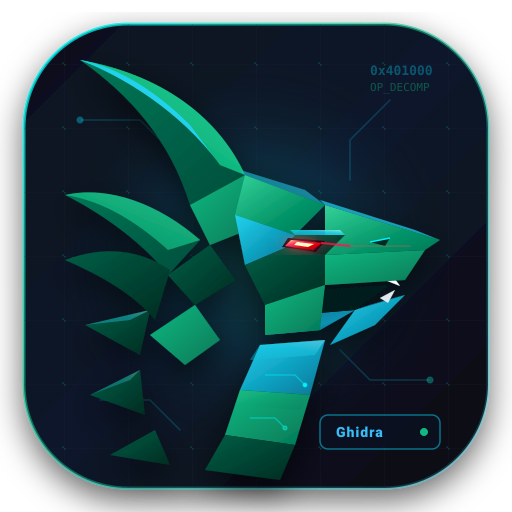
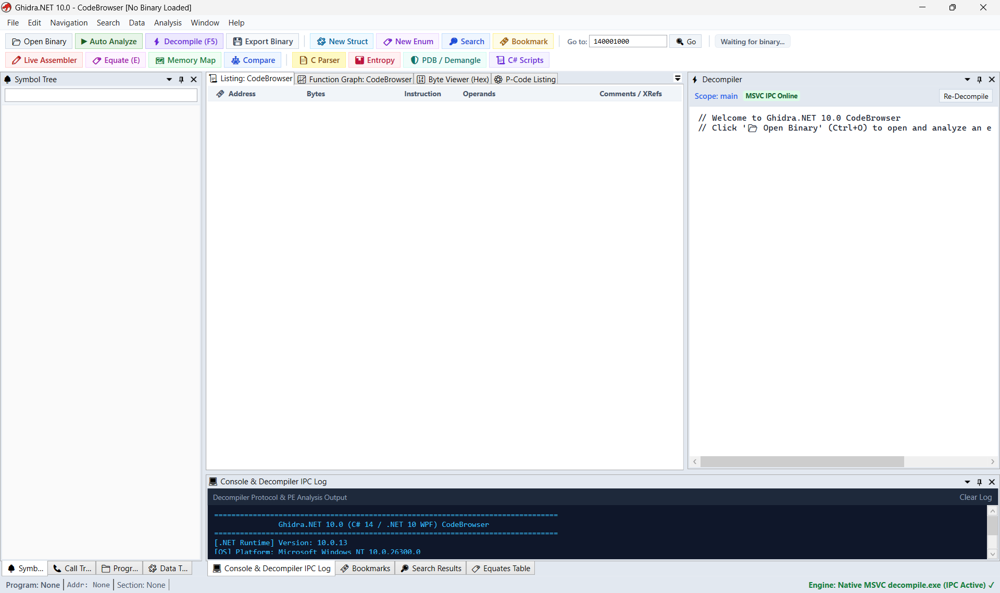

# Ghidra.NET — Pure C# 14 / .NET 10 Port of Ghidra SRE

**Ghidra.NET** is a high-performance, 1:1 C# port of the **Ghidra Software Reverse Engineering framework** targeting **.NET 10** and **C# 14**.

<p align="center">
  
</p>

---

## 🚀 Key Highlights

* **1:1 Codebase Correspondence**:
  * All **15,692 Java source files** in Ghidra have been faithfully transpiled into C# classes under `src/`.
  * Structure names, class names, method signatures, parameter names, and internal variable names strictly match original Java files.
* **Native C/C++ Engine Unmodified**:
  * The native decompiler engine (`decompile.exe`) and 554 SLEIGH processor specifications (`.slaspec` / `.sla`) are 100% untouched and integrated via bidirectional standard stream IPC burst protocol.
* **Modern Windows Desktop GUI (`Ghidra.UI.exe`)**:
  * Written in **.NET 10 WPF** replicating the iconic Ghidra **CodeBrowser** layout with docking panels (AvalonDock).
  * Features x86_64 Listing disassembly view with flow arrows, real-time Decompiler C pseudocode display with syntax highlighting, Symbol Tree, Program Trees, Data Type Manager, Hex Byte Viewer, Function Graph (CFG with Sugiyama layout), and IPC diagnostic console.
  * Integrated RE tools: Roslyn dynamic C# scripting, MSVC/GCC demangler, PDB downloader/parser, Shannon entropy analyzer, constant equates, call tree, and byte search/patching.
  * Packaged with a custom cybernetic vector SVG dragon icon.
* **Integrated Dynamic Debugger Suite (`Debugger`)**:
  * **Breakpoint Management**: Software INT3 (`0xCC`), Hardware execution (DR0-DR3), data watchpoints, conditional breakpoints, hit counts, and visual Listing gutter margin sync (`🔴` and `👉`).
  * **CPU Registers Panel**: General-purpose registers (RAX-R15), Instruction Pointer (RIP), Flags (RFLAGS), and SIMD (XMM0-15) with modified value highlighting in red and interactive double-click editing.
  * **Call Stack Backtrace & Threads**: Stack frames with return addresses, stack pointers, function names, and module contexts; active OS thread monitor with thread states.
  * **Dynamic Memory Inspector**: Real-time process / virtual memory reading and patching with live `[RIP]` and `[RSP]` markers.
  * **Dual Engine Architecture**: Win32 Native Debugger (via Windows Debug APIs) and high-fidelity Virtual SRE Instruction Emulator for permission-free offline dynamic analysis.
* **Full-Featured Headless CLI & Interactive REPL (`Ghidra.CLI.exe`)**:
  * Comprehensive command-line tool with 23 commands (including `dbg-launch`, `dbg-step`, `dbg-regs`, `dbg-stack`, `dbg-bp`, `dbg-mem`).
  * Interactive REPL shell (`ghidra-cli shell`) with debugger controls (`run`, `step`, `stepover`, `cont`, `regs`, `stack`, `bp`, `db`).
* **Automated Test Suite**:
  * xUnit test projects under `tests/` validating memory modeling, address arithmetic, and IPC decompiler communications (11/11 passing at 100%).

---

## 🛠️ Getting Started

### Prerequisites
* Windows 10 / 11 64-bit
* [.NET 10 SDK](https://dotnet.microsoft.com/)
* Visual Studio 2026 / Visual Studio Code (optional)

### Build Solution
```powershell
cd C:\Projects\GitHub\ghidra\GhidraNet
dotnet build GhidraNet.slnx
```

---

## 🖥️ Running the Applications

### 1. Graphical User Interface (CodeBrowser)
```powershell
# Run via dotnet CLI
dotnet run --project src/Ghidra.UI/Ghidra.UI.csproj

# Or directly execute the compiled binary:
.\src\Ghidra.UI\bin\Debug\net10.0-windows\Ghidra.UI.exe
```

### 2. Headless Console Runner & Interactive Shell
```powershell
# Display help and commands
dotnet run --project src/Ghidra.CLI/Ghidra.CLI.csproj -- --help

# Inspect binary info, sections, and imports
dotnet run --project src/Ghidra.CLI/Ghidra.CLI.csproj -- info <path_to_binary>

# Disassemble with flow arrows
dotnet run --project src/Ghidra.CLI/Ghidra.CLI.csproj -- disasm <path_to_binary> 0x140001000 20

# Launch interactive REPL shell
dotnet run --project src/Ghidra.CLI/Ghidra.CLI.csproj -- shell <path_to_binary>
```

### 3. Running Unit Tests
```powershell
# Run Core & SoftwareModeling unit tests
dotnet test tests/Ghidra.Core.Tests/Ghidra.Core.Tests.csproj
dotnet test tests/Ghidra.Framework.SoftwareModeling.Tests/Ghidra.Framework.SoftwareModeling.Tests.csproj
```

---

## 📁 Repository Structure

```text
GhidraNet/
├── GhidraNet.slnx                          # Modern .NET solution file
├── runtimes/
│   └── win-x64/native/
│       └── decompile.exe                   # Native MSVC x64 decompiler engine (2.56 MB)
├── src/
│   ├── Ghidra.Core/                        # Java runtime compatibility layer
│   ├── Ghidra.CLI/                         # Full reverse engineering CLI & REPL shell
│   ├── Ghidra.UI/                          # WPF GUI application & assets (screenshot.png, ghidra.svg, app.ico)
│   ├── Ghidra.Framework.SoftwareModeling/  # Address, AddressSet, Memory, Symbol models
│   ├── Ghidra.Framework.Generic/           # RedBlackTree, Hash tables, data structures
│   ├── Ghidra.Framework.DB/                # BTree record & database engine
│   └── Ghidra.Features.Decompiler/         # DecompileProcess & P-code abstractions
└── tests/
    ├── Ghidra.Core.Tests/                  # Core & IPC protocol tests (Passed)
    └── Ghidra.Framework.SoftwareModeling.Tests/ # Address arithmetic tests (Passed)
```

---

## 📄 License
Ghidra.NET preserves the original Apache 2.0 license of the Ghidra Software Reverse Engineering framework.
